  

# 🚀 Awesome Unified Work Management & Workspace 🌐

  
  
  
  
  
  

> 💡 **A curated list of leading SaaS Unified Work Management platforms, modern digital workspaces, and top self-hosted open-source collaboration hubs.**

Unified Work Management (UWM) platforms consolidate tasks, documents, spreadsheets, relational databases, goals, and team communications into a single connected workspace. By bridging structured project tracking and unstructured knowledge management, unified workspaces eradicate cross-app tool sprawl and align daily execution with strategic organizational goals. 🎯

---

## 📑 Table of Contents

- [📊 Sector Overview & Market Dynamics](#-sector-overview--market-dynamics)
- [💼 SaaS & Hosted Workspace Platforms](#-saas--hosted-workspace-platforms)
- [🛠️ Open-Source GitHub Projects](#️-open-source-github-projects)
  - [📚 All-in-One Workspaces & Knowledge Bases](#-all-in-one-workspaces--knowledge-bases)
  - [✅ Task, Issue & Project Management](#-task-issue--project-management)
  - [🗄️ Relational Database Workspaces](#️-relational-database-workspaces)
- [🔍 Key Selection Criteria](#-key-selection-criteria)
- [⭐ Star History](#-star-history)
- [💖 Support & Community](#-support--community)
- [🤝 How to Contribute](#-how-to-contribute)
- [📜 Disclaimer & License](#-disclaimer--license)

---

## 📊 Sector Overview & Market Dynamics

The global Unified Work Management and Collaborative Work Management (CWM) software market is estimated at **$10.5 billion to $13.2 billion**, projected to grow at a CAGR of ~13.5% toward **$26 billion+**. 📈

The sector is **moderately fragmented yet increasingly concentrated around category behemoths** that leverage strong platform moats and enterprise bundle dynamics:
- 🏢 **Megacap Enterprise Ecosystems**: Giant ecosystems like Microsoft 365 (via Microsoft Planner, Loop, Teams) and HubSpot capture baseline workspace needs through suite bundling.
- ⚡ **Category Leaders & Work OS Consolidators**: High-growth pure-plays—including Notion, Monday.com, Asana, ClickUp, and Smartsheet—compete aggressively as multi-product "Work OS" platforms consolidating tasks, docs, and automations.
- 🔓 **The Modern Open-Source Landscape**: Open-source workspaces are fragmented across distinct functional domains (such as AppFlowy/AFFiNE for knowledge docs, Plane for agile task execution, and NocoDB/Teable for database management). This fragmentation creates strong demand for extensible, self-hosted, all-in-one alternatives (e.g., Huly) that combat commercial vendor lock-in and safeguard enterprise data sovereignty.

---

## 💼 SaaS & Hosted Workspace Platforms

The table below covers top-tier commercial SaaS work management and productivity workspace platforms, sorted in descending order by company scale (market capitalization or private valuation).

| Platform | 🏢 Company Valuation / Revenue Scale | 💳 Starting Tier Pricing | 🎁 Free Tier / Trial Limits | 🌟 Primary Use Case & Key Highlights |
| :--- | :--- | :--- | :--- | :--- |
| **[Microsoft 365](https://www.microsoft.com/en-us/microsoft-365)** | **$3.1T+ Market Cap** (Microsoft Corporation) | **$6.00/user/month** (annual commitment, Microsoft 365 Business Basic) | **30-Day Free Trial** (up to 25 user licenses with full access to web/mobile apps, 1 TB OneDrive storage/user, Exchange email, and Teams) | Integrated enterprise suite uniting Planner (unified Project for the web & To Do), Loop workspaces, SharePoint, and Teams. |
| **[HubSpot Workspace](https://www.hubspot.com/)** | **~$28B Market Cap** (NYSE: HUBS) | **$15/seat/month** (billed annually, Starter Customer Platform) | **Free Forever Plan** (up to 5 users, includes CRM contacts, tasks, ticketing, shared inbox, document tracking, and quotes) | Unified customer-centric workspace tying tasks, deals, docs, and communication pipelines directly to CRM records. |
| **[Monday.com](https://monday.com/)** | **~$13B Market Cap** (NASDAQ: MNDY) | **$9/seat/month** (billed annually, $27/mo min for 3 seats on Basic Plan) | **Free Forever Plan** (up to 2 seats, 3 boards, 200+ templates, 500 MB storage; 14-day Pro trial with unlimited boards/automations) | Highly visual Work OS with customizable boards, automations, Gantt charts, and dashboards for cross-departmental operations. |
| **[Smartsheet](https://www.smartsheet.com/)** | **~$8.4B Valuation** (Acquired / Taken Private by Blackstone & Vista) | **$9/user/month** (billed annually, Pro Plan, up to 10 members) | **Free Forever Plan** (1 user + up to 2 editors, 2 sheets, 500 MB storage; 30-day Enterprise-featured trial available) | Spreadsheet-native enterprise work execution platform with automated workflows, portfolio rollup reporting, and resource management. |
| **[Notion](https://www.notion.com/)** | **~$10B Valuation** (Private / Last Equity Financing Round) | **$10/user/month** (billed annually, Plus Plan, $12/user billed monthly) | **Free Forever Plan** (unlimited pages/blocks for individuals, up to 10 guest collaborators, 5 MB file upload limit, 7-day page history) | Modular, block-based workspace combining wikis, collaborative docs, relational databases, AI agents, and sprint tracking. |
| **[Airtable](https://www.airtable.com/)** | **~$11B Valuation** (Private / Series F Benchmark) | **$20/seat/month** (billed annually, Team Plan, $24/seat billed monthly) | **Free Forever Plan** (up to 5 creators/editors, 1,000 records per base, 1 GB attachment storage per base, up to 100 automation runs/month) | Relational database-spreadsheet hybrid with custom drag-and-drop interface designer, workflows, and low-code integrations. |
| **[ClickUp](https://clickup.com/)** | **~$4B Valuation** (Private / Series C Valuation) | **$7/user/month** (billed annually, Unlimited Plan, $10/user billed monthly) | **Free Forever Plan** (unlimited members, 100 MB storage, 100 automations/mo, 100 Mind Maps, up to 5 spaces, full task management) | Comprehensive "One app to replace them all" featuring tasks, whiteboards, dashboards, documents, time tracking, and goals. |
| **[Asana](https://asana.com/)** | **~$3B Market Cap** (NYSE: ASAN) | **$10.99/user/month** (billed annually, Starter Plan, $13.49 billed monthly) | **Free Forever Plan** (up to 10 teammates, unlimited tasks/projects/messages/activity log, 100MB file uploads, list/board/calendar views) | Enterprise work management with cross-team dependencies, portfolio rollups, workload balancing, and strategic goal tracking. |
| **[Coda](https://coda.io/)** | **~$1.4B Valuation** (Private / Series D Benchmark) | **$10/Doc Maker/month** (billed annually, Pro Plan, Editors & Viewers are always free) | **Free Forever Plan** (unlimited unshared doc makers, up to 50 objects per doc, 10 MB per attachment, 35+ basic document packs) | All-in-one interactive canvas blending documents, spreadsheets, buttons, automations, and formulas into custom web applications. |
| **[Basecamp](https://basecamp.com/)** | **Bootstrapped / High-Profitability SMB Leader** (37signals) | **$15/user/month** (monthly pay-as-you-go) or **$299/month flat** (unlimited users, Pro Unlimited) | **30-Day Free Trial** (full unrestricted access to all features, to-dos, Campfires, message boards, and docs; no credit card required) | Calm, opinionated project management and team collaboration with message boards, chat, to-dos, automatic check-ins, and file storage. |

---

## 🛠️ Open-Source GitHub Projects

The open-source ecosystem offers self-hosted, privacy-first, and extensible alternatives to commercial work management suites. Below are the top open-source projects, **ranked by GitHub Stars in descending order**. 🌟

### 📚 All-in-One Workspaces & Knowledge Bases

- **[AppFlowy](https://github.com/AppFlowy-IO/AppFlowy)**   
  *Open-source, privacy-first alternative to Notion built with Flutter and Rust.*  
  AppFlowy delivers an offline-first workspace combining rich-text document editing, nested pages, kanban boards, database tables, and AI agents while ensuring absolute user data ownership and native cross-platform performance. 📱💻

- **[AFFiNE](https://github.com/toeverything/AFFiNE)**   
  *Next-generation knowledge operating system fusing Notion-style docs with Miro-like spatial whiteboards.*  
  AFFiNE treats structured markdown documents and visual infinite canvases as two views of the same underlying data block structure, powered by local-first CRDT synchronization and Docker self-hosting. 🎨

- **[Joplin](https://github.com/laurent22/joplin)**   
  *Secure, open-source note-taking and work notebook with end-to-end encryption (E2EE).*  
  Captures notes, to-dos, and web clippings organized into notebooks and tags, synchronizing seamlessly across mobile and desktop devices via Nextcloud, Dropbox, WebDAV, or Joplin Cloud. 🔐

- **[Outline](https://github.com/outline/outline)**   
  *Blazing-fast, intuitive collaborative knowledge base for growing teams.*  
  Designed as a modern Confluence/Notion alternative with real-time markdown editing, nested collections, granular permissions, read receipts, and seamless enterprise SSO (OIDC/SAML). 📖

- **[Huly](https://github.com/hcengineering/platform)**   
  *All-in-one open-source workspace replacing Linear, Jira, Slack, Notion, and Motion.*  
  Combines issue tracking, sprint management, team chat, audio virtual office spaces, collaborative documents, and unified calendars into a singular, ultra-responsive web and desktop environment. 🚀

- **[Docmost](https://github.com/docmost/docmost)**   
  *Open-source collaborative wiki and team documentation platform.*  
  Features real-time collaborative rich-text editing, space-based organization, page hierarchy, asset management, and user permissions for team knowledge bases. 📝

- **[Standard Notes](https://github.com/standardnotes/app)**   
  *Zero-knowledge, end-to-end encrypted notes and work productivity application.*  
  Provides an extensible architecture for spreadsheets, markdown documents, code snippets, tasks, and file storage with hardened cryptography and long-term data durability. 🛡️

- **[Initiative](https://github.com/beyonders-studio/initiative)**   
  *Self-hosted unified workspace for communities and teams.*  
  Integrates task boards, tables, calendars, collaborative documents, whiteboards, and a modular plug-in registry across desktop and mobile platforms. 🌐

- **[Cloudillo](https://github.com/cloudillo/cloudillo)**   
  *Decentralized, self-hosted alternative to Google Workspace and Notion.*  
  Leverages CRDT-powered real-time synchronization, passkey authentication, and federated nodes to unify docs, presentations, spreadsheets, tasks, and wikis. ☁️

---

### ✅ Task, Issue & Project Management

- **[Plane](https://github.com/makeplane/plane)**   
  *Modern open-source Jira, Linear, Monday, and ClickUp alternative.*  
  Offers issues tracking, cycles (sprints), modules, custom workflows, pages, time estimates, and five dynamic layout views (List, Kanban Board, Calendar, Spreadsheet, Gantt). ✈️

- **[Focalboard](https://github.com/mattermost-community/focalboard)**   
  *Self-hosted multilingual project management platform from Mattermost.*  
  Acts as a dedicated open-source Trello, Notion, and Asana alternative with kanban boards, table grids, and card-level custom metadata properties. 📌

- **[Super Productivity](https://github.com/super-productivity/super-productivity)**   
  *Advanced personal to-do list, time tracker, and work organizer with Jira/GitHub/GitLab integrations.*  
  Integrates time tracking, Pomodoro timer, break reminders, and automated issue synchronization without requiring user registration or third-party servers. ⏱️

- **[Wekan](https://github.com/wekan/wekan)**   
  *Battle-tested open-source collaborative kanban board platform.*  
  Offers self-hosted agile board management with member permissions, swimlanes, custom fields, checklists, and calendar views across multi-platform deployments. 📋

- **[OpenProject](https://github.com/opf/openproject)**   
  *Enterprise-grade open-source project management and work collaboration suite.*  
  Features classic Gantt project timelines, agile boards, cost reporting, bug tracking, resource planning, and comprehensive project portfolio management. 📊

- **[Planka](https://github.com/plankanban/planka)**   
  *Real-time kanban tracking board for small teams and developers.*  
  Built with React and Redux, featuring project boards, list customization, card timers, attachments, markdown descriptions, and user mentions. 🗂️

- **[Leantime](https://github.com/leantime/leantime)**   
  *Open-source strategic work and project management system tailored for non-project managers.*  
  Combines lean methodology, goal tracking, milestone Gantt roadmaps, idea boards, and ADHD-friendly task execution workflows. 💡

- **[Kaneo](https://github.com/usekaneo/kaneo)**   
  *Lightweight, high-speed open-source project management platform with Model Context Protocol (MCP).*  
  Provides board, list, calendar, and Gantt views with custom fields, subtasks, time tracking, Gitea/GitHub integrations, and native MCP support for AI agent orchestration. ⚡

- **[Vikunja](https://github.com/go-vikunja/vikunja)**   
  *The self-hostable to-do and work organizer built in Go and Vue.*  
  Features subtasks, attachments, priorities, recurring intervals, reminders, task relations, CalDAV sync, and kanban/gantt/table task perspectives. 🦙

- **[Tududi](https://github.com/chrisvel/tududi)**   
  *Calm, minimalist productivity and project workspace system.*  
  Organizes personal and professional life across notes, projects, spaces, and intelligent prioritization without cognitive overwhelm. 🧘

---

### 🗄️ Relational Database Workspaces

- **[NocoDB](https://github.com/nocodb/nocodb)**   
  *Open-source Airtable alternative transforming any SQL database into a smart relational spreadsheet.*  
  Connects to MySQL, PostgreSQL, SQL Server, and SQLite to provide grid, kanban, gallery, and form views with programmatic REST and GraphQL APIs. 🗃️

- **[Teable](https://github.com/teableio/teable)**   
  *High-performance, Postgres-native Airtable alternative capable of scaling to millions of rows.*  
  Delivers real-time spreadsheet interfaces, complex formula engines, custom views, and fast relational aggregation built directly atop PostgreSQL. ⚡

- **[APITable](https://github.com/apitable/apitable)**   
  *API-first, open-source collaborative database and visual workflow builder.*  
  Enables developers to construct complex internal business tools, automated CRM pipelines, and data-driven workspaces with multi-table links and automated triggers. 🔌

---

## 🔍 Key Selection Criteria

When evaluating unified work management platforms for organizational deployment, consider the following trade-offs:

1. **Workspace Architecture**:
   - 📄 *Doc-Centric Workspaces* (Notion, AFFiNE, AppFlowy, Outline): Optimal for documentation-heavy workflows, engineering wikis, product specs, and creative drafting.
   - 📋 *Task & Sprint Workspaces* (Plane, Huly, Monday, ClickUp, Asana): Ideal for cross-functional sprint planning, roadmap execution, and SLA-governed task operations.
   - 📊 *Data-Driven Workspaces* (Airtable, NocoDB, Teable, Coda): Built for custom inventory, pipeline management, applicant tracking, and dynamic computational tables.

2. **Self-Hosting vs. Commercial SaaS**:
   - ☁️ *Commercial SaaS*: Accelerates onboarding with turnkey mobile apps, third-party integrations, enterprise identity (SAML SSO/SCIM), and managed compliance (SOC 2 Type II, ISO 27001).
   - 🖥️ *Self-Hosted Open Source*: Guarantees total data residency, eliminates recurring seat licensing fees, protects proprietary company knowledge, and allows programmatic customization.

---

##  Star History

---

## 💖 Support & Community

If this curated repository saved you time or helped you design your team's workspace architecture, please consider supporting the project:

- ⭐ **Star this repository** to help others discover it on GitHub!
- 🍴 **Fork and share** with colleagues, DevOps leads, and engineering managers.
- ☕ **Sponsor & Buy a Coffee**: Support ongoing maintenance and curation via the [GitHub Sponsors Dashboard](https://github.com/sponsors/ishandutta2007).

Thank you for your generous support and dedication to open source! 🙌

---

## 🤝 How to Contribute

We welcome community contributions! To suggest a new platform or update existing entries:

1. Fork this repository.
2. Add your entry following the established table or list format.
3. Ensure all links point to authoritative product sites or active GitHub repositories.
4. Verify pricing tiers, free tier constraints, and GitHub star counts.
5. Submit a pull request detailing the platform and its architectural significance.

---

## 📜 Disclaimer & License

- This list is independently curated by the open-source community for educational and technical evaluation purposes.
- Trademarks, logos, and brand names belong to their respective corporate owners.
- Repository licenses vary across open-source projects (including MIT, AGPL-3.0, Apache-2.0, and MPL-2.0). Review each project repository before commercial implementation.

Distributed under the [Creative Commons Zero v1.0 Universal](LICENSE) license.
